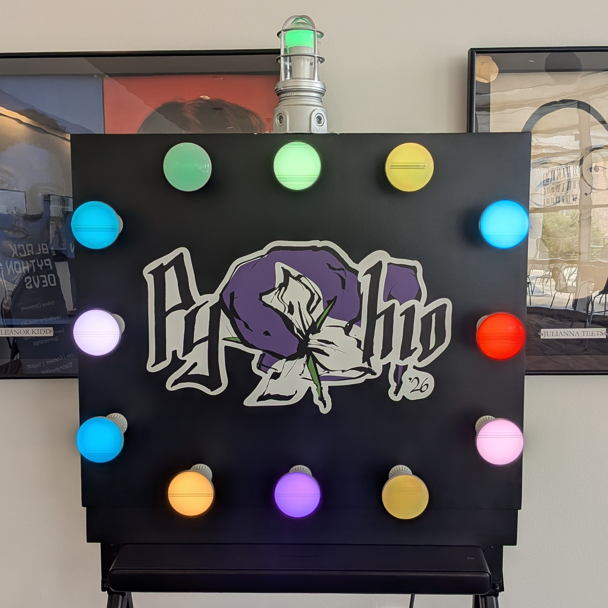
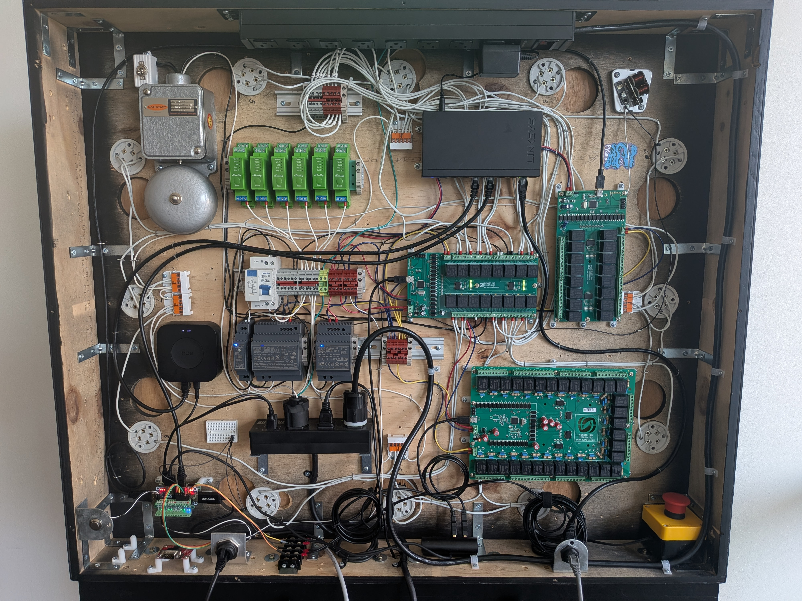
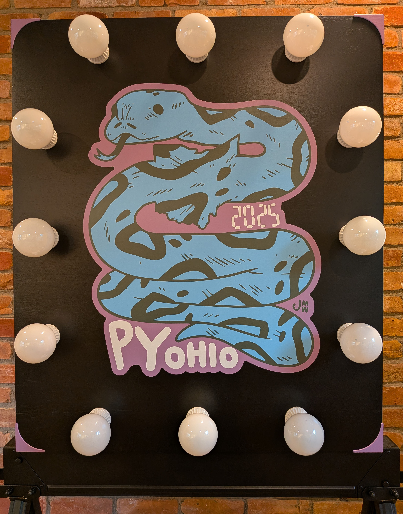
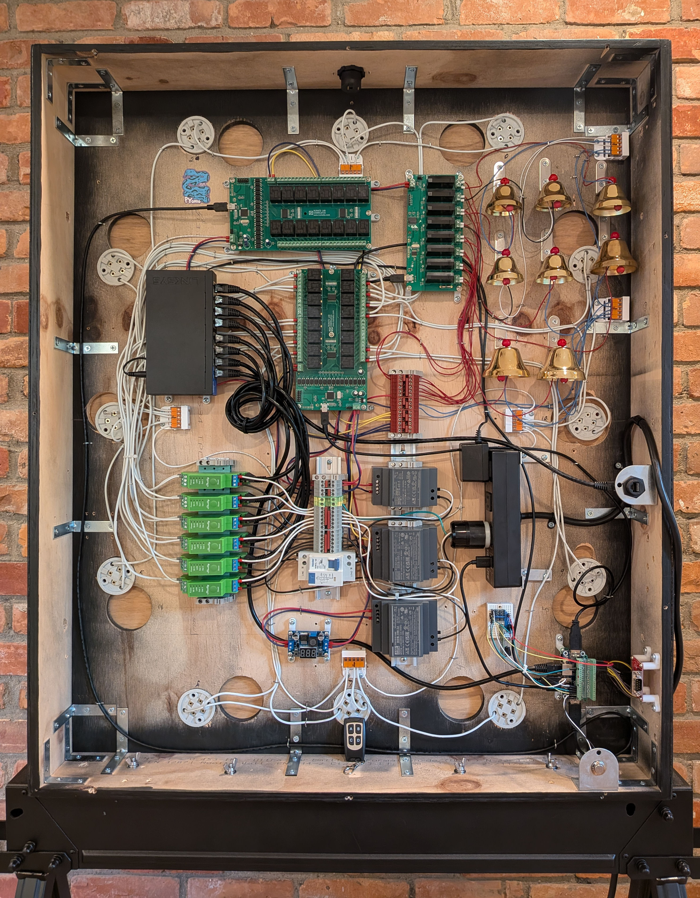
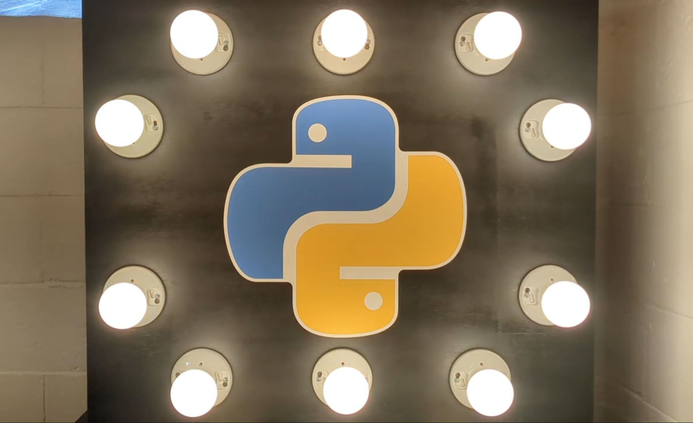
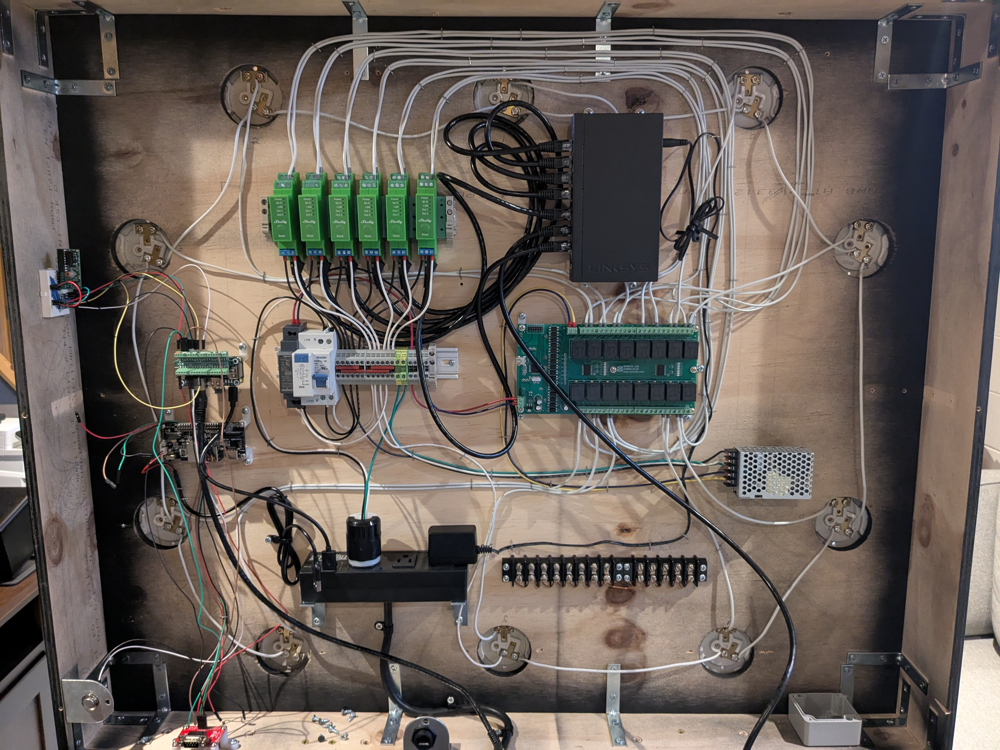
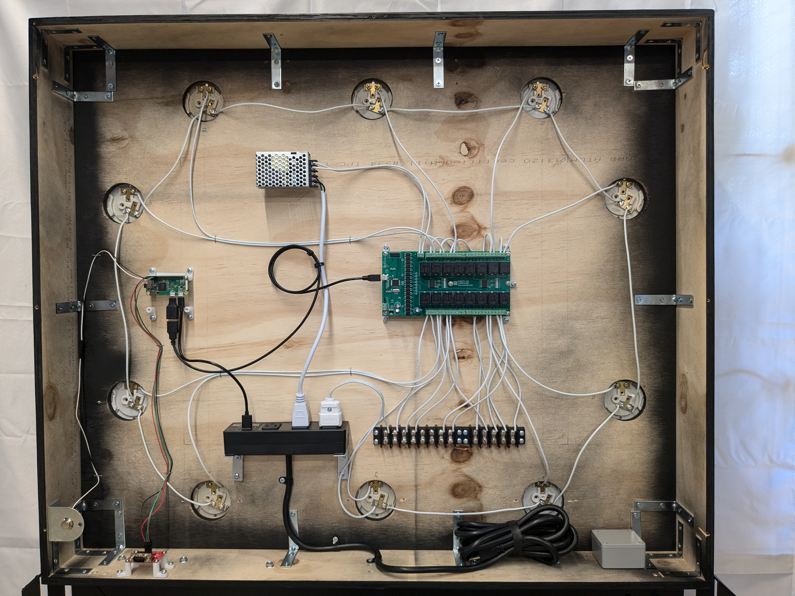
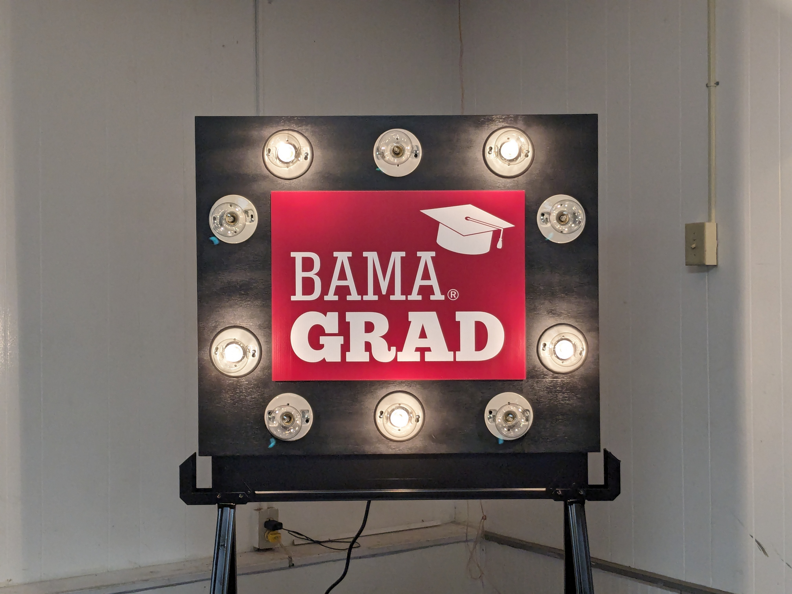

# **Marquee Animated Sign**

## **Version 5**

 <b>Version 5.1.0, which I presented at the Dayton Dynamic Languages Group meeting on October 14, 2026, includes the following:</b>
* API server with FastAPI and an initial 9 endpoints.
* Input and output state and actions decoupled from hardware.
* Test mode with mocks, allowing application to be run without any devices present.
* Musical notation support for sustained notes.

 <b>Version 5.0.0, [which I presented at PyOhio 2026](https://www.youtube.com/watch?v=-QKWLWoR_gQ), and [which was popular in the 'hallway track'](https://fosstodon.org/@pyohio/117004508001189473), includes the following:</b>
* Support for Philips Hue light bridge and bulbs.
* Event-driven control flow, used throughout.
* New devices:
* * Beautiful new-old-stock industrial lamp and ringer bell.
* * Rinky-dink old buzzer.
* * More clicky relays!
* Sound files played concurrently with instruments.
* New performances:
* * March Of The New Old Stock
* * Twelve (Sesame Street)
* * Signs '26
* * Can It Run Doom? (No!)
* New game, with arcade controls and primitive game engine:
* * Pac-Man

## **Version 4**

**Version 4.0.0, [which I presented at PyOhio 2025](https://www.youtube.com/watch?v=-3euk5EPddU), includes the following:**
* Upgraded to 12 lights, including a new front face and new aesthetically pleasing light fixtures.
* Added musical bells, with supporting relay board and power supplies.
* Added the Signs performance, as shown in the above video.
* Added auto mode, allowing a selection of modes to be cycled through automatically.

## **Version 3**

**Version 3.5.0 includes the following:**
* Added dimmers, allowing independent control of each bulb's brightness.
* Added basic musical notation and playback.
* Added 2nd relay board, operating as a drum set.
* Added **[demo utilizing dimmers, new music facilities, and drums](https://www.youtube.com/watch?v=Xw9Ktnp-iGw)**.  

## **Version 2**

## **Version 1**

I had wanted to make this project for a while, and our son's graduation from the University Alabama was the excuse I needed.  
While the Raspberry Pi and other electronics are relatively modern, the incandescent bulbs and ceramic lamp holders gave it a retro feel, as do the mechanical relays, whose clicks resonate in the wooden cabinet. 
